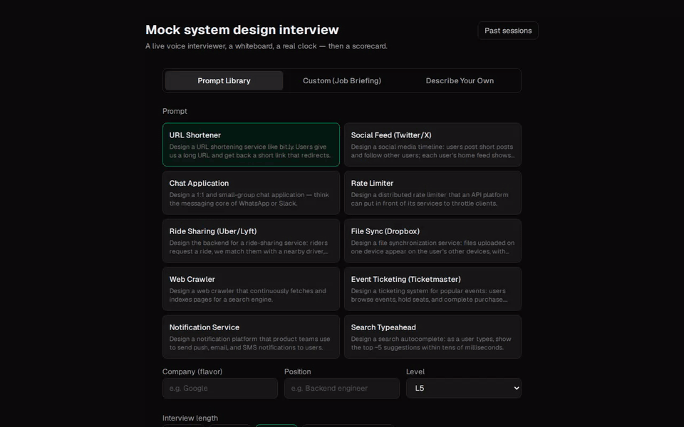

A voice-driven mock system design interview: draw on an Excalidraw whiteboard while an AI interviewer probes, then get a timestamped scorecard and the call recording.

Practicing system design alone means nobody answers your clarifying questions, challenges your design, or keeps time. This app plays the interviewer by voice, watches your whiteboard, and grades the session afterwards. It is for engineers preparing for system design interviews who have an OpenAI project with access to a Live voice model.

## Install and run

You need Node.js 22.18 or newer (`.nvmrc` pins the version CI uses) and an OpenAI API key.

```bash
git clone https://github.com/jkhoffman/system-design-coach.git
cd system-design-coach
nvm use
npm ci
echo "OPENAI_API_KEY=sk-..." > .env
npm run dev
```

Open http://localhost:3000. Model names and other settings are optional environment variables; see [docs/configuration.md](docs/configuration.md). No separate database server is needed, because the app uses Node's built-in SQLite module.

## Usage

Pick a library prompt, generate one from a company and role briefing, or describe the interview you want in your own words. Choose a duration, then join with your microphone and speaker. Talk through the problem and draw on the whiteboard; the interviewer answers clarifying questions, probes your design, and wraps up on time. When you end the interview, the review page shows the scorecard, the recording, and a replayable transcript and board timeline.



The demo uses simulated interview responses and grading. [docs/demo-recording.md](docs/demo-recording.md) explains how it is refreshed.

## Architecture

The app is a Next.js application. The browser talks to the Live model over WebRTC through a server route that holds the API key, attaches the interviewer persona and a hidden fact sheet, and forwards the session offer. The main design decision is the split of work: the Live model handles the conversation at low latency, with the fact sheet in its instructions, while deeper reasoning about the design is delegated to a Responses model that can ask for a fresh image of the whiteboard through a `view_whiteboard` tool. Whiteboard changes are summarized and pushed to the interviewer on each drawing pause. Interviews, transcripts, snapshots and recordings are saved under `data/` in SQLite and files, and a separate grading model scores the saved material. See [docs/how-it-works.md](docs/how-it-works.md) for the full flow.

## Tests

```bash
npm test
```

This runs the deterministic suites, which need no OpenAI key. Lint, typecheck, the mocked browser end-to-end test and the paid live smoke tests are described in [docs/testing.md](docs/testing.md).
